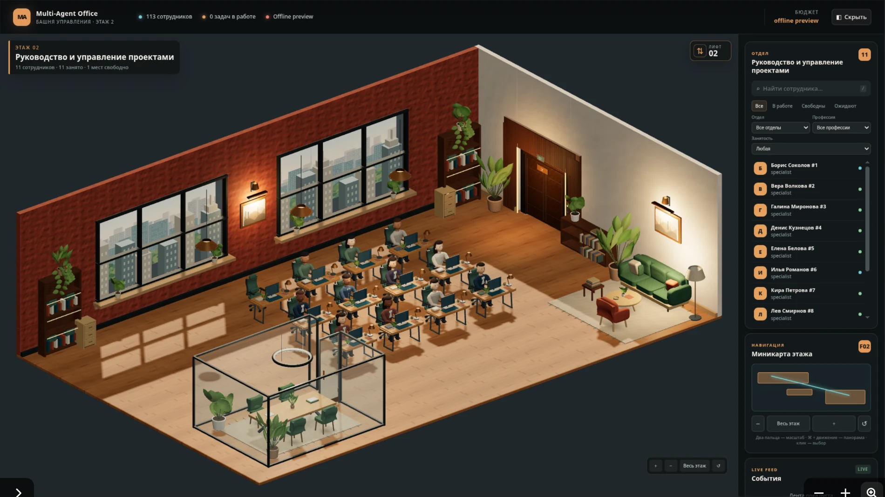
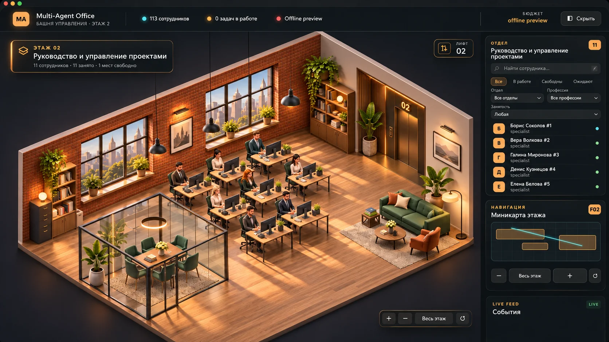

<div align="center">

# 🏢 Multi-Agent Office

### Your AI team deserves more than a terminal.

**Превратите набор ИИ-моделей в команду, которой можно управлять.**  
Виртуальный офис, специализированные агенты, единый центр задач и интерактивный мир, в котором видно, как устроена работа.

**3D-first · Local-first · Multi-agent · Open source**

[](#статус-проекта)
[](#технологии)
[](#живой-3d-офис)
[](#лицензия-и-ресурсы)

[Возможности](#почему-mao) · [Посмотреть офис](#живой-3d-офис) · [Запустить](#быстрый-старт) · [Архитектура](#как-это-устроено) · [Roadmap](#куда-мы-движемся)

</div>

---

## Искусственный интеллект становится ближе, когда у него появляется команда

Представьте, что вы заходите в офис и видите не безликий список чатов, а **собственную цифровую компанию**. У каждого сотрудника есть профессия, рабочее место, инструменты и задачи. Разработчики создают код, аналитики изучают информацию, инженеры проектируют решения, а руководитель распределяет работу между подходящими специалистами.

Именно такую систему мы создаём в **Multi-Agent Office (MAO)**.

MAO объединяет три мира: **оркестрацию ИИ-агентов**, **инструменты разработки** и **интерактивный 3D-интерфейс**. Его цель — сделать сложные процессы понятными, управляемыми и наблюдаемыми: от идеи до результата.

> [!IMPORTANT]
> **Текущий выпуск — Alpha 0.1.0, а не законченный коммерческий продукт.** 3D-офис и ряд инфраструктурных модулей уже реализованы; полноценная автономная работа команды над несколькими проектами, сквозные рабочие сценарии и автоматическая связь игровых действий с выполнением задач ещё развиваются. Ниже возможности текущей версии и планы обозначены отдельно.

## Живой 3D-офис

### Вот как выглядит реальная Alpha



*Скриншот работающей версии Floor 02 (GFX-33), не рекламный рендер. Более поздние GFX-34/35 дополнили композицию и локальные анимации; их новые кадры можно добавить после финальной визуальной приёмки.*

Офис — это не заставка и не статичная иллюстрация. Это **сцена на Three.js** с настоящей геометрией, материалами, камерой, объектами и взаимодействиями.

- **15 этажей** в структуре здания. Сейчас именно второй этаж имеет детализированную игровую 3D-сцену; остальные используют более простое представление.
- **113 профилей виртуальных сотрудников** в общей структуре офиса и **132 слота рабочих мест**.
- На **Floor 02** размещены **11 сотрудников и 12 рабочих мест**, одно из которых остаётся резервным.
- Рабочее пространство с компьютерами, креслами, растениями, панорамными окнами и предметами интерьера.
- Стеклянная переговорная, зона отдыха с диваном, столиками и освещением.
- **Интерактивный лифт** с дверями, панелью управления и переключением этажей.
- Управление камерой: обзор, перемещение, масштабирование, возврат к виду этажа.
- Индивидуальные персонажи с разной одеждой, причёсками и привязкой к рабочим местам.

### Визуальное направление



*Художественный концепт / visual target. Это **не** скриншот текущей игры: мы постепенно приближаем к нему реальные модели, освещение и материалы.*

Дизайн сочетает спокойную изометрическую перспективу, тёплую древесину, атмосферный свет, выразительных персонажей и эстетику премиальной игры. Мы хотим, чтобы в этом офисе было приятно не только работать, но и просто наблюдать за жизнью команды.

## Почему MAO

<table>
<tr><td width="50%" valign="top">

### 👥 Команда вместо одного чата

Агент — не просто модель с новым именем. В архитектуре предусмотрены специализированные профили, роли, инструменты, инструкции и контекст выполнения. Руководитель сможет подбирать нужных исполнителей под задачу.

</td><td width="50%" valign="top">

### 🧠 Разные модели — один офис

Вместо привязки к одной модели проект строится вокруг runtime-адаптеров и общей оркестрации. Уже разрабатывается интеграция с **OpenCode**; универсальное подключение дополнительных сред — часть дальнейшей архитектуры.

</td></tr>
<tr><td valign="top">

### 🛠 От задачи к результату

Цель MAO — помогать создавать сайты и приложения, писать код и тесты, анализировать данные, готовить инженерную документацию и координировать междисциплинарные проекты. Полный автономный цикл ещё находится в разработке.

</td><td valign="top">

### 🎮 Наблюдаемый процесс

Работа становится понятнее, когда сотрудники, отделы, места и события представлены в пространстве. При этом интерфейс должен отличать **реальное событие выполнения** от **декоративной анимации**.

</td></tr>
<tr><td valign="top">

### 💡 Разумное использование ресурсов

Сложные задачи можно делить на этапы, ограничивать параллелизм и учитывать бюджет модели. Цель проекта — направлять дорогие вычисления туда, где они действительно нужны.

</td><td valign="top">

### 🖥 Локальный контроль

Приложение ориентировано на запуск на собственном компьютере, возможность работы с локальными проектами и явное управление инструментами и разрешениями.

</td></tr>
</table>

## Сотрудники, которые выглядят живыми

В MAO есть принципиально важное разделение:

**Интеллектуальная работа** — задача, переданная модели через Runtime, с реальными результатами, ошибками и расходом токенов.

**Офисная жизнь** — движение персонажей, позы, печатание, прогулки и локальные сценарии, которые исполняются на компьютере пользователя **без дополнительных обращений к LLM**.

В экспериментальном модуле **GFX-35** уже созданы компоненты для управления позами и суставами персонажа, планировщик анимаций, навигационный адаптер и сценарий **рабочее место → зона отдыха → рабочее место**. Добавлены кадры визуальных проверок и сценарные тесты. Финальная приёмка художественного качества и надёжности всё ещё продолжается.

В следующих версиях офис сможет реагировать на настоящие события: агент получил задачу, приступил к работе, ожидает инструмент, просит подтверждение, завершил этап. При этом **анимация никогда не должна выдавать себя за реальную работу нейросети**.

## Один офис — множество специализаций

Планируемая команда охватывает разные направления: разработку и тестирование, аналитику и исследование, дизайн, 3D-моделирование, инженерию, документацию, безопасность, качество и координацию проектов.

Система проектируется так, чтобы **113 профилей сотрудников не означали 113 одновременно запущенных LLM**. Нужные роли будут выбираться по задачам, а число активных исполнителей можно ограничивать в соответствии с ресурсами и бюджетом.

### Пример будущего рабочего процесса

```text
Владелец проекта
      │
      ▼
«Создать веб-приложение с личным кабинетом»
      │
      ▼
Director / Orchestrator
      │
      ├── Analyst       → требования и ограничения
      ├── Architect     → структура решения
      ├── Developer     → реализация
      ├── Tester        → проверка
      └── Reviewer      → итоговая оценка
      │
      ▼
Код + тесты + документация + отчёт
```

*Это целевой сценарий продукта, а не заявление о том, что весь конвейер уже полностью автоматизирован в Alpha 0.1.0.*

## Как это устроено

MAO построен как TypeScript-монорепозиторий с раздельными интерфейсом, общими контрактами, адаптерами выполнения и оркестрацией.

```text
┌───────────────────────────────────────────────────────┐
│                    MAO OFFICE                         │
│        3D Tower · Directory · Tasks · UI              │
└─────────────────────────┬─────────────────────────────┘
                          │
┌─────────────────────────▼─────────────────────────────┐
│                 ORCHESTRATION                         │
│        Routing · Sessions · Events · Policies         │
└─────────────┬─────────────────────┬───────────────────┘
              │                     │
┌─────────────▼───────────┐ ┌───────▼───────────────────┐
│      RUNTIME LAYER     │ │     BUDGET / LIMITS       │
│    OpenCode adapter    │ │   Guard · Usage · Policy  │
└─────────────┬───────────┘ └───────────────────────────┘
              │
┌─────────────▼─────────────────────────────────────────┐
│      EXTERNAL MODELS / TOOLS / LOCAL PROJECTS         │
└───────────────────────────────────────────────────────┘

Игровая симуляция работает рядом с этим контуром,
но не запускает LLM-запросы ради визуальных действий.
```

### Структура репозитория

```text
apps/
  office/                 # пользовательский интерфейс и 3D-офис
    src/office-3d/       # сцена, материалы, персонажи, GFX-модули
    src/integration/     # интеграция интерфейса башни
packages/
  shared/                 # общие типы и контракты
  orchestrator/           # управление средами исполнения и сессиями
  runtime-opencode/      # адаптер OpenCode
  budget-manager/        # политики бюджета и ограничений
```

В проекте также есть экспериментальные и исторические модули разработки, тесты и инструменты проверки. Не все внутренние компоненты уже подключены в единый production workflow.

## Технологии

| Область | Технологии / подход |
| --- | --- |
| Интерфейс | TypeScript, React, Three.js |
| Организация кода | pnpm workspace / monorepo |
| Графика | WebGL, GLB, PBR-материалы, текстуры, управляемая камера |
| Персонажи | TypeScript-контроллеры поз, маршруты, локальный animation scheduler |
| Оркестрация | Runtime Manager, контракты сессий и событий |
| Исполнение | Адаптер OpenCode; расширяемая архитектура Runtime |
| Контроль затрат | Политики бюджета, учёт использования, ограничения |
| Качество | TypeScript, автоматические frontend- и WebGL-проверки |

## Быстрый старт

### Требования

- **Node.js** совместимой с репозиторием версии и **Corepack**;
- **Git**;
- браузер с поддержкой **WebGL**;
- доступ к GitHub-репозиторию (если он пока приватный).

### 1. Получить исходники

```bash
git clone https://github.com/Dendy3CTD/Multi-Agent-Office.git
cd Multi-Agent-Office
```

### 2. Установить зависимости

```bash
corepack pnpm install
```

### 3. Запустить офис

```bash
corepack pnpm --dir apps/office dev --host 127.0.0.1 --port 3333
```

Откройте **http://127.0.0.1:3333/**.

> [!NOTE]
> Эта команда запускает локальный интерфейс. Настройка реальных агентов, моделей и интеграций может требовать дополнительных шагов; визуальный offline preview не равен запущенной LLM-команде.

### Режимы 3D-демонстрации

| Адрес | Назначение |
| --- | --- |
| `http://127.0.0.1:3333/` | Основное приложение MAO |
| `http://127.0.0.1:3333/?gfx35=demo` | Локальный демонстрационный сценарий анимации GFX-35 |
| `http://127.0.0.1:3333/?gfx35=off` | Отключение GFX-35 для сравнения поведения |
| `http://127.0.0.1:3333/?gfx32=legacy` | Сравнение с прежними моделями персонажей |

Демонстрационный сценарий GFX-35 **не создаёт настоящих задач агентов** и **не расходует LLM-токены**. Параметры предназначены для разработки и проверки, их доступность может меняться.

## Что уже работает и что ещё предстоит

| Подсистема | Состояние Alpha 0.1.0 |
| --- | --- |
| Структура 15 этажей | Реализована |
| Подробная Three.js-сцена Floor 02 | Рабочий прототип |
| Directory: 113 сотрудников / 132 места | Реализована структура данных |
| Интерактивный лифт, панель, переходы | Реализовано в 3D-сцене |
| Модели 11 сотрудников Floor 02 | Реализовано, внешний вид дорабатывается |
| Маршруты и GFX-35 анимации | Экспериментальная интеграция, окончательная приёмка впереди |
| Адаптер OpenCode и Runtime Manager | Реализованы базовые компоненты |
| Автономная работа отделов над проектами | В разработке |
| Сценарный режиссёр поведения GFX-36 | Запланирован |
| Связь анимаций с реальными агентными задачами GFX-37 | Запланирована |
| Детальные 3D-сцены остальных этажей | Запланированы |

## Куда мы движемся

**01 · Живой офис.** Довести движения персонажей, естественные жесты и маршруты до качества увлекательной изометрической игры. Добавить локальные сценарии офисной жизни без расхода токенов.

**02 · Реальная активность команды.** Связать визуальные статусы сотрудников с подтверждёнными событиями оркестратора. Показывать реальные задачи, прогресс и результаты.

**03 · Универсальные исполнители.** Развивать Runtime-адаптеры, выбор подходящих моделей, проверку результатов, управление сессиями и контроль разрешений.

**04 · Несколько проектов одновременно.** Поддержка разных рабочих пространств, последовательной и ограниченно параллельной работы, отчётов, истории и файлов проекта.

**05 · Полноценный цифровой штаб.** Новые 3D-этажи и специализированные пространства, терминал агентов, инженерные и дизайнерские рабочие процессы, интеграции с инструментами разработчика.

## Для кого создаётся MAO

**Для разработчика**, который устал управлять множеством терминалов вручную.  
**Для инженера**, которому нужны разные эксперты — от схемы устройства до документации.  
**Для небольшой команды**, которая хочет видеть задания, ответственных и результаты в одном месте.  
**Для энтузиаста ИИ**, которому интересны прозрачная оркестрация, локальное управление и игровые интерфейсы.

MAO — это взгляд на будущее, в котором **человек управляет работой целой команды ИИ через одну понятную среду**.

## О проекте и участии

Разработка ведётся итеративно. Приветствуются идеи, сообщения об ошибках, предложения по архитектуре, анимациям и улучшению пользовательского опыта. Перед отправкой изменений ознакомьтесь с текущими контрактами и тестами в соответствующих пакетах.

Для обратной связи используйте [Issues репозитория](https://github.com/Dendy3CTD/Multi-Agent-Office/issues), если они открыты.

## Лицензия и ресурсы

В корне репозитория расположен файл [`LICENSE`](LICENSE) — он определяет условия использования исходного кода. **Лицензия на код не обязательно распространяется на сторонние текстуры, модели, иллюстрации, шрифты и другие медиафайлы.** Права на отдельные ассеты должны проверяться независимо; до завершения такой проверки не следует считать весь медиаконтент свободным для перепубликации.

Изображения в этом README: первый кадр — реальный интерфейс Alpha, второй — художественный концепт будущего качества. Это разные типы материалов.

---

<div align="center">

### Multi-Agent Office

**Build a team. Give it a workspace. Make intelligence visible.**

*Идея: одна цифровая команда, один офис, множество возможностей.*

[↑ Вернуться наверх](#-multi-agent-office)

</div>
