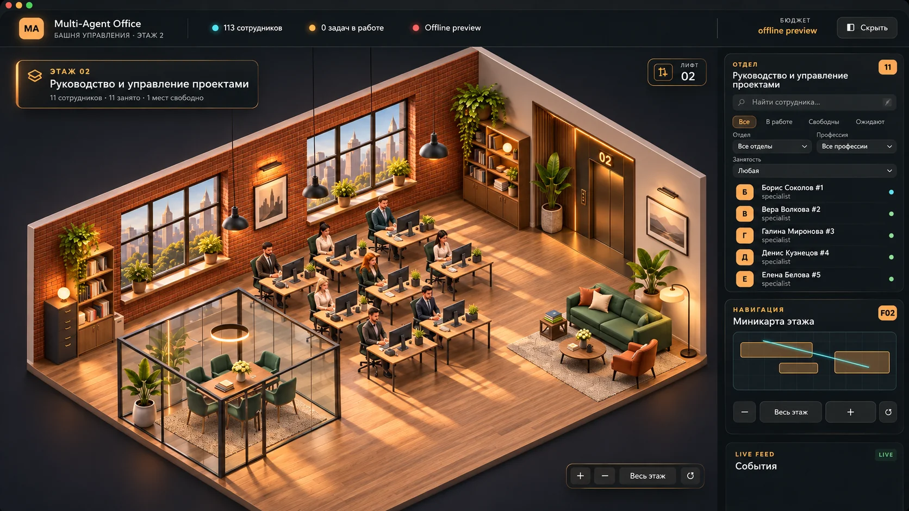

<div align="center">

# 🏢 Multi-Agent Office

### Your AI team deserves more than a terminal.

**Превратите набор ИИ-моделей в команду, которой можно управлять.**  
Виртуальный офис, специализированные агенты, единый центр задач и интерактивный мир, в котором видно, как устроена работа.

**3D-first · Local-first · Multi-agent · Open source**

[](#что-уже-работает-и-что-ещё-предстоит)
[](#технологии)
[](#живой-3d-офис)
[](#лицензия-и-ресурсы)

[Возможности](#почему-mao) · [Посмотреть офис](#живой-3d-офис) · [Запустить](#быстрый-старт) · [Архитектура](#как-это-устроено) · [Roadmap](#куда-мы-движемся)

</div>

---

## Искусственный интеллект становится ближе, когда у него появляется команда

Представьте, что вы заходите в офис и видите не безликий список чатов, а **собственную цифровую компанию**. У каждого сотрудника есть профессия, рабочее место, инструменты и задачи. Разработчики создают код, аналитики изучают информацию, инженеры проектируют решения, а руководитель распределяет работу между подходящими специалистами.

Именно такую систему мы создаём в **Multi-Agent Office (MAO)**.

MAO объединяет три мира: **оркестрацию ИИ-агентов**, **инструменты разработки** и **интерактивный 3D-интерфейс**. Его цель — сделать сложные процессы понятными, управляемыми и наблюдаемыми: от идеи до результата.

> [!IMPORTANT]
> **v0.1.0-preview — ранняя версия, а не готовый автономный цифровой офис.** 3D-офис, очередь, storage, Runtime и тестовые multi-project сценарии развиваются как отдельные части. Подключение production Runtime к Office и полная приёмка реальных задач ещё впереди; ниже тестовые результаты отделены от production E2E.

## Живой 3D-офис

### Вот как выглядит реальная Alpha


*Скриншот работающей версии Floor 02 (GFX-33), не рекламный рендер. Более поздние GFX-34/35 дополнили композицию и локальные анимации; их новые кадры можно добавить после финальной визуальной приёмки.*

Офис — это не заставка и не статичная иллюстрация. Это **сцена на Three.js** с настоящей геометрией, материалами, камерой, объектами и взаимодействиями.

- **15 этажей** в структуре здания; одновременно отображается выбранный этаж, между этажами можно переключаться через меню и лифт.
- **113 профилей виртуальных сотрудников**, **12 отделов** и **132 слота рабочих мест** в организационной модели офиса.
- Наиболее детализирована интерактивная Three.js-сцена **Floor 02**; остальные этажи пока имеют разную глубину визуальной проработки.
- На **Floor 02** размещены **11 сотрудников и 12 рабочих мест**, одно из которых остаётся резервным.
- Рабочее пространство с компьютерами, креслами, растениями, панорамными окнами и предметами интерьера.
- Стеклянная переговорная, зона отдыха с диваном, столиками и освещением.
- **Интерактивный лифт** с дверями, панелью управления и переключением этажей.
- Управление камерой: обзор, перемещение, масштабирование, возврат к виду этажа.
- Индивидуальные персонажи с разной одеждой, причёсками и привязкой к рабочим местам.

### Визуальное направление



*Художественный концепт / visual target. Это **не** скриншот текущей игры: мы постепенно приближаем к нему реальные модели, освещение и материалы.*

Дизайн сочетает спокойную изометрическую перспективу, тёплую древесину, атмосферный свет, выразительных персонажей и эстетику премиальной игры. Мы хотим, чтобы в этом офисе было приятно не только работать, но и просто наблюдать за жизнью команды.

## Почему MAO

<table>
<tr><td width="50%" valign="top">

### 👥 Команда вместо одного чата

Агент — не просто модель с новым именем. В архитектуре предусмотрены специализированные профили, роли, инструменты, инструкции и контекст выполнения. Руководитель сможет подбирать нужных исполнителей под задачу.

</td><td width="50%" valign="top">

### 🧠 Разные модели — один офис

Проект строится вокруг общей Runtime-архитектуры. Сейчас основной путь — **Codex CLI с авторизацией ChatGPT** через отдельный защищённый Supervisor. Адаптер OpenCode остаётся в коде, но сейчас отключён и не считается активным production Runtime.

</td></tr>
<tr><td valign="top">

### 🛠 От задачи к результату

MAO предназначен для разработки, проектирования, анализа и инженерной работы. В коде есть регистрация проектов, очередь и независимые DAG, Reviewer и управление исполнением; multi-project acceptance 5/5 проверена с fake Runtime. Реальные задачи через Office ещё требуют production Host E2E.

</td><td valign="top">

### 🎮 Наблюдаемый процесс

Работа становится понятнее, когда сотрудники, отделы, места и подтверждённые события представлены в пространстве. GFX-36/37 отображает только явно подтверждённые статусы; текущая связка с production Runtime ещё ожидает E2E.

</td></tr>
<tr><td valign="top">

### 💡 Разумное использование ресурсов

Budget Manager проверяет admission до запуска, учитывает сообщённый Runtime usage и ограничивает параллельность двумя агентами. Неизвестная стоимость или остаток подписки остаются UNKNOWN; платный fallback не подразумевается.

</td><td valign="top">

### 🖥 Локальный контроль

Приложение ориентировано на локальные проекты и явные разрешения. Production-путь разделяет Core и System Supervisor: в нём предусмотрены systemd sandbox, выделенная execution identity и проверки UID/GID и cgroup v2. Фиксированный non-LLM Host probe проверил эту границу; обычное production-выполнение Codex ещё ожидает E2E.

</td></tr>
</table>

## Сотрудники, которые выглядят живыми

В MAO есть принципиально важное разделение:

**Интеллектуальная работа** — задача, переданная модели через Runtime, с реальными результатами, ошибками и расходом токенов.

**Офисная жизнь** — движение персонажей, позы, печатание, прогулки и локальные сценарии, которые исполняются на компьютере пользователя **без дополнительных обращений к LLM**.

**GFX-35** реализует локальный цикл анимации **рабочее место → зона отдыха → рабочее место**, планировщик и управление позой; браузерная проверка этого цикла проходила 56/56 проверок. Он не создаёт агентные задачи и не расходует LLM-токены. **GFX-36** передаёт в сцену только подтверждённые состояния сотрудников; **GFX-37** отображает соответствующие статусы и badges. Оба этапа входят в Stage E, где 28/28 unit/integration tests и browser fixtures прошли в тестовом окружении. Это не доказывает production Runtime execution: локальная анимация и тестовые статусы не заменяют серверное событие.

В следующих версиях офис сможет реагировать на настоящие события: агент получил задачу, приступил к работе, ожидает инструмент, просит подтверждение, завершил этап. При этом **анимация никогда не должна выдавать себя за реальную работу нейросети**.

## Один офис — множество специализаций

Каталог охватывает 12 отделов и 113 виртуальных сотрудников: разработка, тестирование, аналитика, дизайн, 3D-моделирование, инженерия, документация, безопасность, качество и координация проектов.

**113 профилей не означают 113 одновременно запущенных моделей.** Система ограничивает число параллельных исполнений до двух и требует budget admission перед каждым запуском.

### Пример будущего рабочего процесса

```text
Владелец проекта
      │
      ▼
«Создать веб-приложение с личным кабинетом»
      │
      ▼
Director / Orchestrator
      │
      ├── Analyst       → требования и ограничения
      ├── Architect     → структура решения
      ├── Developer     → реализация
      ├── Tester        → проверка
      └── Reviewer      → итоговая оценка
      │
      ▼
Код + тесты + документация + отчёт
```

*Это целевой сценарий. DAG, назначения, Reviewer и восстановление проверены в acceptance harness с fake Runtime; полный реальный multi-project цикл ещё впереди.*

## Как это устроено

MAO построен как TypeScript-монорепозиторий с раздельными интерфейсом, общими контрактами, адаптерами выполнения и оркестрацией.

```text
┌──────────────────────┐
│   OFFICE UI / 3D     │
└──────────┬───────────┘
           │ authenticated loopback API
┌──────────▼───────────┐
│ CORE / SERVER        │──────────────┐
│ Director · Task Run. │              │
└──────────┬───────────┘              │
           │                           │
┌──────────▼───────────┐     ┌─────────▼───────────────┐
│ ORCHESTRATOR         │────▶│ BUDGET MANAGER          │
│ Scheduler · Reviewer │     │ admission · max 2 LLM   │
└──────────┬───────────┘     └─────────┬───────────────┘
           │                           │ approved execution
┌──────────▼───────────┐               │
│ RUNTIME MANAGER      │◀──────────────┘
└──────────┬───────────┘
           │ authenticated Supervisor IPC
┌──────────▼───────────┐
│ TRUSTED SYSTEM       │
│ SUPERVISOR           │
└──────────┬───────────┘
           │ systemd sandbox · cgroup v2
┌──────────▼───────────┐
│ mao-exec → Codex CLI  │
└──────────────────────┘

          STAGE C · PERSISTENT STORAGE
┌──────────────────────┐  ┌───────────────────────────┐
│ TASK QUEUE · SQLite  │  │ SAFETY STORE · SQLite     │
│ projects · DAG/events│  │ durable execution binding │
└──────────────────────┘  └───────────────────────────┘
             ┌────────────────────────────┐
             │ BUDGET · admission/usage   │
             │ max 2 · UNKNOWN stays so   │
             └────────────────────────────┘

Office animation is local; it does not start models or spend LLM tokens.
```

Production Codex dispatch is implemented in code, but Host E2E through the
trusted System Supervisor is still pending. The Supervisor validates the
durable execution binding before dispatch; termination observation is kept
separate from trusted termination attestation, and uncertainty fails closed.
Stage A's A1–A4 PASS covers a separate fixed non-LLM host probe. OpenCode is
currently disabled and is not shown as an active dispatch path.

### Структура репозитория

```text
apps/
  server/                 # Core, локальный API, Task Runner и SQLite queue
  supervisor/             # system-level Supervisor entrypoint (production integration)
  office/                 # пользовательский интерфейс и 3D-офис
    src/office-3d/         # сцена, материалы, персонажи, GFX-35/36/37
    src/integration/       # Office и live-state projection
packages/
  shared/                 # общие типы и контракты
  directory/              # сотрудники, профессии и отделы
  orchestrator/           # Scheduler, Runtime Manager, Reviewer flow
  runtime-codex/          # Codex CLI и Supervisor IPC
  runtime-opencode/       # OpenCode adapter (сейчас отключён)
  model-manager/          # Model Gateway и каталог моделей
  budget-manager/         # admission, usage, parallelism policy
  archive/                # SQLite-backed Markdown archive/export
```

Queue, Runtime Safety Store, admission/usage ledgers и workspace roots относятся к persistent state. Тесты подтверждают storage/recovery и project isolation в своих пределах; реальное выполнение обычной задачи через всю цепочку ещё не прошло Host E2E.

## Технологии

| Область | Технологии / подход |
| --- | --- |
| Интерфейс | TypeScript, React, Three.js |
| Организация кода | pnpm workspace / monorepo |
| Графика | WebGL, GLB, PBR-материалы, текстуры, управляемая камера |
| Персонажи | TypeScript-контроллеры поз, маршруты, локальный animation scheduler |
| Оркестрация | Runtime Manager, контракты сессий и событий |
| Исполнение | Codex CLI через отдельный system-level Supervisor; OpenCode сейчас отключён |
| Защита исполнения | systemd sandbox, отдельная execution identity, проверка UID/GID и cgroup v2 |
| Контроль затрат | Budget admission, учёт сообщённого usage, максимум два параллельных исполнения |
| Качество | TypeScript, автоматические frontend- и WebGL-проверки |

## Быстрый старт

### Требования

- **Node.js 22 или новее**, **Corepack** и **pnpm 12.16.1** через Corepack;
- **Git**;
- браузер с поддержкой **WebGL**;
- доступ к GitHub-репозиторию (если он пока приватный).

### 1. Получить исходники

```bash
git clone https://github.com/Dendy3CTD/Multi-Agent-Office.git
cd Multi-Agent-Office
```

### 2. Установить зависимости

```bash
corepack pnpm install
```

### 3. Запустить офис

```bash
corepack pnpm --dir apps/office dev --host 127.0.0.1 --port 3333
```

Откройте **http://127.0.0.1:3333/**.

> [!NOTE]
> Эта команда запускает локальный интерфейс. Настройка реальных агентов, моделей и интеграций может требовать дополнительных шагов; визуальный offline preview не равен запущенной LLM-команде.

### Реальный Runtime

Для исполнения задач нужны Linux с systemd и cgroup v2, подготовленный system-level Supervisor, Codex CLI с авторизацией через ChatGPT и разрешённая рабочая область. Production Dispatch и Host E2E ещё проходят приёмку; не запускайте Runtime как root и не обходите подтверждения.

Команда `mao-local onboard-codex` предназначена для явной настройки Codex Runtime: она задаёт исполняемый файл, отдельный runtime root, Codex Home, workspace и модель, а затем требует подтверждения оператора для авторизации, подписки, модели, workspace, budget admission и исполнения. Отдельный Codex Home изолирует состояние CLI от личного профиля; onboarding не копирует личные credentials. Режим исполнения остаётся закрытым, пока оператор явно не подтвердит все необходимые условия.

Подтверждённый `login status` в отдельном Codex Home сам по себе не доказывает, что сетевой запрос к модели успешно выполнится. В отдельной попытке наблюдалась региональная ошибка 403; её устранение пока не подтверждено. Подробности, ограничения и безопасный порядок подготовки собраны в [руководстве по разработке и Runtime](docs/DEVELOPMENT.md).

### Режимы 3D-демонстрации

| Адрес | Назначение |
| --- | --- |
| `http://127.0.0.1:3333/` | Основное приложение MAO |
| `http://127.0.0.1:3333/?gfx35=demo` | Локальный демонстрационный сценарий анимации GFX-35 |
| `http://127.0.0.1:3333/?gfx35=off` | Отключение GFX-35 для сравнения поведения |
| `http://127.0.0.1:3333/?gfx32=legacy` | Сравнение с прежними моделями персонажей |

Демонстрационный сценарий GFX-35 **не создаёт настоящих задач агентов** и **не расходует LLM-токены**. Параметры предназначены для разработки и проверки, их доступность может меняться.

## Что уже работает и что ещё предстоит

| Подсистема | Проверенный статус v0.1.0-preview |
| --- | --- |
| Stage A — A1–A4 | Host E2E PASS для фиксированного non-LLM probe: IPC, confinement-наблюдения, termination и restart/re-attach Supervisor. Это не приёмка обычной production-задачи или полного crash recovery Core. |
| Stage B — Production Dispatch | Реализация dispatch в коде; production Host E2E через доверенный Supervisor ожидает подтверждения. |
| Stage C — Persistent Storage | SQLite, локальное хранение и onboarding реализованы; соответствующие тесты пройдены. Реальную миграцию пользовательских данных это не подтверждает. |
| Stage D — Multi-Project | 5/5 acceptance checks PASS на fake Runtime: два проекта, независимые DAG, Reviewer с Evidence Package, квоты, два слота и восстановление SQLite. Реальный multi-project E2E впереди. |
| Stage E — Office Integration | 28/28 тестов PASS; GFX-35 browser check — 56/56. UI → production Runtime ещё не подтверждён. |
| Codex Home | `login status` подтвердил вход через ChatGPT, но сетевое выполнение модели не доказано; отдельно наблюдалась нерешённая региональная ошибка 403. |
| Codex execution | Ранее был успешный single-task Codex CLI smoke/E2E с артефактом и проверкой после перезапуска. Это исторический прямой запуск, не Host E2E текущего Supervisor-gated Production Dispatch. |
| Production acceptance | Реальные production-задачи текущего защищённого dispatch ещё не прошли приёмку. |
| Obsidian | Реализован SQLite-backed Markdown archive/exporter; подключение и эксплуатация персонального vault не подтверждаются этим релизным статусом. |
| Runtime limits | Budget admission перед запуском; не более двух одновременно исполняемых агентов. UNKNOWN allowance/стоимость остаются неизвестными, без платного fallback. |
| Codex / OpenCode | Codex — целевой Runtime; OpenCode adapter остаётся в коде, но сейчас отключён. |
| 15 этажей / 113 профилей / 12 отделов / 132 места | Каталог и офисная модель реализованы; детализация 3D-этажей различается. |
| Floor 02, лифт и локальная анимация | Three.js сцена интерактивна; GFX-35 локальная анимация не запускает LLM. |
| GFX-36/37 и статусы Office | Adapter и UI projection покрыты Stage E тестами/fixtures; поток от production Runtime ещё впереди. |
| Agent Terminal и полностью автономная команда | В планах; не считаются готовыми возможностями. |

## Куда мы движемся

**01 · Закрыть Production Dispatch E2E.** Подтвердить обычное выполнение задачи через Core и доверенный system-level Supervisor, включая результат, артефакты, termination evidence и сохранённое состояние.

**02 · Выполнять задачи через Office.** Провести приёмку полного пути от пользовательского запроса и Director до Reviewer, SQLite и отображения результата в Office.

**03 · Одновременно работать над двумя проектами.** Проверить независимые workspace и состояния на реальном Runtime при сохранении budget admission и лимита двух активных исполнений.

**04 · Связать Runtime-события с состояниями сотрудников.** Передавать в Office только подтверждённые состояния задач и исполнений; локальная анимация останется визуальным слоем.

**05 · Развивать офис и инструменты.** Улучшать 3D-графику и этажи, Agent Terminal, рабочие процессы и автономность постепенно, после надёжной production-приёмки.

## Для кого создаётся MAO

**Для разработчика**, который устал управлять множеством терминалов вручную.  
**Для инженера**, которому нужны разные эксперты — от схемы устройства до документации.  
**Для небольшой команды**, которая хочет видеть задания, ответственных и результаты в одном месте.  
**Для энтузиаста ИИ**, которому интересны прозрачная оркестрация, локальное управление и игровые интерфейсы.

MAO — это взгляд на будущее, в котором **человек управляет работой целой команды ИИ через одну понятную среду**.

## О проекте и участии

Разработка ведётся итеративно. Приветствуются идеи, сообщения об ошибках, предложения по архитектуре, анимациям и улучшению пользовательского опыта. Перед отправкой изменений ознакомьтесь с текущими контрактами и тестами в соответствующих пакетах.

Для обратной связи используйте [Issues репозитория](https://github.com/Dendy3CTD/Multi-Agent-Office/issues), если они открыты.

## Лицензия и ресурсы

В корне репозитория расположен файл [`LICENSE`](LICENSE) — он определяет условия использования исходного кода. **Лицензия на код не обязательно распространяется на сторонние текстуры, модели, иллюстрации, шрифты и другие медиафайлы.** Права на отдельные ассеты должны проверяться независимо; до завершения такой проверки не следует считать весь медиаконтент свободным для перепубликации.

Изображения в этом README: первый кадр — реальный интерфейс Alpha, второй — художественный концепт будущего качества. Это разные типы материалов.

---

<div align="center">

### Multi-Agent Office

**Build a team. Give it a workspace. Make intelligence visible.**

*Идея: одна цифровая команда, один офис, множество возможностей.*

[↑ Вернуться наверх](#-multi-agent-office)

</div>
