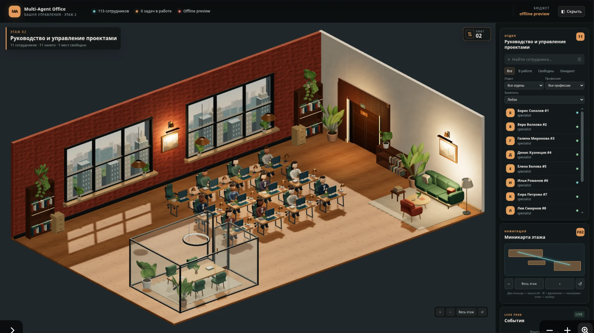
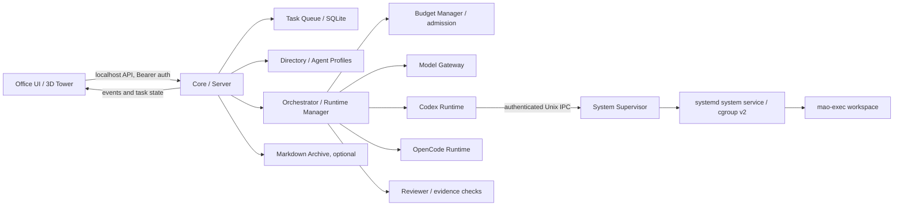

# Open Agent Office (MAO)

**Локальная мультиагентная система с виртуальным офисом для инженерной работы.** Director принимает цель, а специализированные ИИ-сотрудники помогают разбирать задачи, проектировать решения, писать и проверять код. Работа организована вокруг проектов, специалистов и проверяемых результатов, а не вокруг одного бесконечного чата.

> **Статус на 15 ноября 2026 года:** интерфейс, базовые Core-компоненты и тестовые сценарии развиваются отдельно от production dispatch. Host E2E A1–A4 для фиксированного non-LLM probe отмечен как пройденный; подключение обычных задач к production Core → Runtime ещё находится в работе. Подробности и границы доказательств — в [STATUS.md](docs/STATUS.md).



*Скриншот текущего виртуального офиса. Изображение целевого визуального направления находится в [mao-visual-target.webp](docs/images/mao-visual-target.webp) и не является скриншотом приложения.*

## Что решает MAO

В обычном AI-чате пользователь сам удерживает в голове проекты, роли, последовательность действий и состояние проверки. MAO предназначен для другой модели работы: несколько проектов живут в общей системе, Director может распределять этапы между профильными сотрудниками, Runtime выполняет работу, а Reviewer сопоставляет результат с критериями приёмки.

Сотрудник — это виртуальная рабочая роль с профессией, отделом, моделью и рабочим местом. Это организационная модель: 113 виртуальных сотрудников **не** означают 113 одновременно запущенных моделей. Текущий целевой предел — два параллельных LLM execution; бюджет admission и Runtime safety gate могут отказать в запуске.

## Возможности и готовность

| Возможность | Текущий статус |
| --- | --- |
| Director и специализированные сотрудники | Каталог ролей и базовые Core-потоки реализуются; автономная production-декомпозиция ещё не принята целиком. |
| 113 виртуальных сотрудников и 12 отделов | Представлены в каталоге и организационной модели. |
| 15 этажей виртуального офиса | Структура башни предусмотрена; интерактивный уровень и глубина проработки этажей различаются. |
| Несколько проектов и отдельные рабочие пространства | Проверены на тестовом Core с fake Runtime; production multi-project E2E ещё не подтверждён. |
| DAG задач и назначения специалистов | Контракт и тестовые сценарии есть; полноценный автоматический Director workflow развивается. |
| Reviewer | Проверка результата включена в тестовый workflow; production Reviewer с реальными результатами требует завершения Production Dispatch. |
| Codex и OpenCode | Runtime-адаптеры предусмотрены. Codex проходил отдельный CLI smoke; выполнение обычной задачи через production Core не подтверждено. OpenCode требует отдельной проверки реального CLI и авторизации. |
| Supervisor и Debian sandbox | Host E2E A1–A4 для фиксированного безопасного probe отмечен PASS. Это не означает, что обычные production-задачи уже направляются через production Supervisor. |
| Бюджет и параллельность | Есть admission-политика, учёт usage и ограничение до двух активных LLM. Неизвестное allowance остаётся UNKNOWN; точная стоимость не выводится из числа токенов. |
| Постоянное хранение и восстановление | SQLite и durable safety state предусмотрены; тесты clean-init и восстановления проходят в изолированных сценариях. |
| Интерактивный 3D-офис | Реализованы сцена, рабочие места, камера и перемещение между этажами; глубина визуализации зависит от этажа. |
| Agent Terminal | Запланирован отдельный интерфейс структурированных Runtime-событий; не должен имитировать активность. |
| Obsidian | Есть локальный Markdown-архив, совместимый с форматом Obsidian. Автоматическая запись в личный vault и подключение к production-событиям не считаются включёнными по умолчанию. |

Результаты тестов и production-проверки не смешиваются: см. [матрицу готовности](docs/STATUS.md).

## Виртуальный офис

Башня состоит из 15 этажей. В приложении одновременно показан выбранный этаж; переключение выполняется через меню этажей. На этаже сотрудники привязаны к рабочим местам и специализациям. Камера поддерживает обзор, перемещение и масштабирование. Состояния, полученные из подтверждённых событий, должны отображаться отдельно от локальной анимации: движение персонажа само по себе не доказывает запуск модели.

## Архитектура



Диаграмма показывает целевой путь. Production Dispatch ещё подключается; наличие модулей не означает, что каждый Runtime уже доступен из production Core. Подробные границы доверия описаны в [docs/ARCHITECTURE.md](docs/ARCHITECTURE.md).

Основные модули:

- `apps/server` — локальный HTTP API, аутентификация, health/readiness и композиция Core.
- `packages/orchestrator` — Runtime Manager, scheduling и координация исполнения.
- `packages/runtime-codex`, `packages/runtime-opencode` — адаптеры CLI и структурированные Runtime-события.
- `apps/supervisor` и systemd/cgroup boundary — отдельный privileged слой запуска; production dispatch остаётся отдельным критерием готовности.
- `packages/model-manager` — Model Gateway, каталог моделей и маршрутизация.
- `packages/budget-manager` — admission, лимиты параллельности, usage и budget policy.
- `packages/task-queue` — durable очередь, задачи и события в SQLite.
- `packages/directory`, `packages/agent-profiles` — сотрудники, отделы, профессии и профили.
- `packages/archive` — локальный Markdown-архив; `apps/office` — интерфейс и 3D-офис.

## Требования

- Debian 13 или совместимый Linux для полного локального сценария.
- Node.js **22 или новее**.
- Corepack и pnpm **12.16.1** (версия указана в `package.json`).
- Браузер с WebGL для 3D-интерфейса.
- Для host Supervisor acceptance: systemd 257+, cgroup v2 и заранее подготовленные системные identity/IPC. Host E2E не требует LLM.

## Установка и локальный запуск

Клонируйте репозиторий и установите зависимости:

```bash
git clone https://github.com/Dendy3CTD/Multi-Agent-Office.git
cd Multi-Agent-Office
corepack pnpm install
```

Соберите workspace:

```bash
corepack pnpm build
```

Запустите только интерфейс разработки на loopback:

```bash
corepack pnpm --dir apps/office dev --host 127.0.0.1 --port 3333
```

Откройте <http://127.0.0.1:3333/>. Этот запуск не включает production Runtime и не означает, что агенты выполняют задачи.

Локальный Server имеет package-команды `build` и `start`:

```bash
corepack pnpm --filter @open-agent-office/server build
corepack pnpm --filter @open-agent-office/server start
```

Сервер по умолчанию ограничен loopback; его настройки и token file описаны в [`apps/server/README.md`](apps/server/README.md). Не запускайте весь MAO от root. Не помещайте токены или CLI credentials в репозиторий, `VITE_*`, URL либо логи.

### Supervisor

Проверенный host probe и production deployment — разные вещи. Host E2E A1–A4 подтверждает ограниченный тестовый путь на Debian, но не выдаёт разрешение на включение обычного Codex execution. До завершения Production Dispatch используйте только проверенные deployment-инструкции из соответствующей версии; не придумывайте `systemctl start/enable` команду и не меняйте `executionConfinementReady` вручную. Supervisor запускает только ограниченные процессы исполнителя, не HTTP Server и не всё приложение.

## Разработка и проверки

Команды монорепозитория:

```bash
corepack pnpm test
corepack pnpm typecheck
corepack pnpm build
```

Эти команды проверяют код и тестовые контракты. Fake Runtime, unit-тест и host probe не заменяют production E2E. См. [руководство разработчика](docs/DEVELOPMENT.md), [статус](docs/STATUS.md) и [дорожную карту](docs/ROADMAP.md).

## Безопасность и статус проекта

MAO находится в активной разработке. Не включайте неподтверждённые Runtime, платный fallback или автономную запись в личные проекты. Неизвестный лимит подписки остаётся неизвестным. Production Dispatch, восстановление Core и реальная многопроектная работа должны пройти критерии из P0, прежде чем систему можно будет считать пригодной к длительной автономной эксплуатации.

## Документы

- [Архитектура и trust boundary](docs/ARCHITECTURE.md)
- [Текущая готовность и доказательства](docs/STATUS.md)
- [Дорожная карта](docs/ROADMAP.md)
- [Разработка и команды](docs/DEVELOPMENT.md)
- [Индекс документации](docs/README.md)
