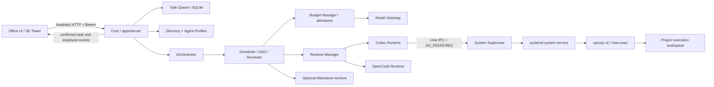

# Архитектура Open Agent Office

Документ описывает кодовую архитектуру и отдельно отмечает границы готовности на **15 ноября 2026 года**. Наличие пакета или зелёных unit-тестов не означает, что его production-путь подключён.

## Общий поток

Схема показывает предусмотренные границы. На дату документа production Dispatch для обычных задач ещё интегрируется. Host acceptance A1–A4 использует фиксированный non-LLM probe и не подменяет production Core → Runtime acceptance.

## Компоненты

| Компонент | Расположение | Роль и фактическое состояние |
| --- | --- | --- |
| Core / Server | `apps/server` | Локальный HTTP API, health/readiness, аутентификация и composition root. Production Dispatch развивается; запуск Server сам по себе не запускает LLM. |
| Orchestrator | `packages/orchestrator` | Runtime Manager, координация execution, scheduling и общие контракты. DAG, Reviewer и несколько проектов проверяются отдельно с fake Runtime; единый реальный workflow ещё не принят. |
| Runtime Manager | `packages/orchestrator` | Регистрация Runtime, admission перед запуском, жизненный цикл execution и safety gate. Не должен обходить durable admission или переводить неизвестное завершение в успех. |
| Supervisor | `packages/runtime-codex` и host-side composition | Отдельная граница полномочий: аутентифицированный IPC и запуск `mao-exec` через systemd. Host probe A1–A4 прошёл; это не означает, что production dispatch обычных задач уже подключён. |
| Codex Runtime | `packages/runtime-codex` | Адаптер Codex CLI, JSONL/event parsing, usage и supervised execution contracts. Отдельный реальный CLI smoke ранее подтверждал адаптер; production Core dispatch — отдельный незавершённый этап. |
| OpenCode Runtime | `packages/runtime-opencode` | Адаптер OpenCode CLI и нормализация Runtime-событий. Включение требует независимо подтверждённых executable, модели, авторизации и readiness. |
| Model Gateway | `packages/model-manager` | Каталог провайдеров/моделей, модельная маршрутизация и совместимость Runtime. Конфигурация модели не является подтверждением доступности или авторизации. |
| Budget Manager | `packages/budget-manager` | Admission, ограничение параллельности, политики и ledger usage. Рабочий предел — до двух активных LLM; стоимость и неизвестный остаток allowance не угадываются. |
| Task Queue | `packages/task-queue` | SQLite-backed задачи, leases, события и durable state. Тестовое восстановление SQLite не доказывает отсутствие повторного реального LLM-вызова без соответствующей safety-проверки. |
| Directory | `packages/directory` | Каталог сотрудников, отделов и назначений. Виртуальные сотрудники — роли каталога, а не отдельные постоянно работающие процессы. |
| Agent Profiles | `packages/agent-profiles` | Профили профессий и специализаций; фактическая автоматическая маршрутизация Director ещё развивается. |
| Archive | `packages/archive` | Локальная Markdown-запись в явно заданный `vaultRoot`, совместимая с Obsidian. Автоматическое подключение к личному vault и полная транзакционная связка с production событиями не включены по умолчанию. |
| Office UI | `apps/office` | React/Three.js приложение, этажи, камера, рабочие места, панели и визуализация подтверждённых состояний. Live-связь с production Runtime ещё не подтверждена end to end. |
| Agent Terminal | `apps/office` / планируемый модуль | Целевой интерфейс структурированных сообщений, tool/test lifecycle и результатов. Не должен читать TUI и выводить фиктивную активность. |

## Trust boundary: Core и Supervisor

1. **UI → Core.** HTTP API предназначен для loopback и защищён токеном. Секреты не передаются в URL и не включаются в клиентскую сборку.
2. **Core-owned durable binding.** Core создаёт execution lease и привязывает к нему `executionId`, `runtimeId`, boot identity и scope. Supervisor не принимает регистрацию, которая не совпадает с подтверждённым durable binding.
3. **Core → Supervisor IPC.** Используется Unix socket и проверка `SO_PEERCRED`: identity клиента берётся из ядра, а не из полей сообщения. IPC не является TCP API и не предоставляет произвольный shell-интерфейс.
4. **Supervisor → systemd.** Privileged Supervisor взаимодействует с system manager; приложение не вызывает `sudo`. Execution запускается от отдельной identity `mao-exec` в выделенном workspace и ограниченном systemd service.
5. **cgroup v2 evidence.** Host acceptance проверяет фактическое членство фиксированного probe в cgroup, UID/GID и эффективные sandbox properties. Завершение сверяется с теми же `InvocationID` и `ControlGroup`; пустое состояние фиксируется через независимое наблюдение `populated=0`.
6. **Termination Attestation.** Core сверяет attestation с binding, boot identity и сохранённым наблюдением. Простое исчезновение PID/unit или пустая строка журнала не является доказательством.
7. **Fail-closed.** Неизвестный binding, потеря supervisor, ошибочное или неполное journal-событие оставляют execution неопределённым и блокируют повторное исполнение. Recovery не открывает safety gate только по таймеру.

Host acceptance A2–A4 PASS относится к фиксированному non-LLM probe: A2 — запуск и confinement; A3 — нормальное прекращение и termination evidence; A4 — restart Supervisor с повторным присоединением к ещё активному execution. A4 не подтверждает полный crash recovery Core.

## Runtime и model routing

Codex и OpenCode реализованы как отдельные адаптеры за общим Runtime-контрактом. Перед production запуском readiness должен подтверждать конкретный executable, протокол, модель, доступность провайдера, авторизацию, одобрение workspace и budget admission. Сам факт наличия CLI недостаточен.

Приёмка A1–A4 не включает платные model calls. Обычный пользовательский task flow через production Core документируется как незавершённый до закрытия Production Dispatch и его отдельного E2E.

## Budget, usage и параллельность

Budget Manager проводит admission до каждого model execution. Целевой и тестируемый предел — два параллельных LLM. Токены, сообщённые Runtime, хранятся как usage; предполагаемая цена и allowance подписки — отдельные данные. Если allowance или цена неизвестны, система сохраняет `UNKNOWN`, а не подставляет ноль или бесконечный лимит.

## Persistent state и изоляция проектов

SQLite хранит durable состояние задач и safety ledger; отдельные JSONL/Markdown stores используются там, где этого требует соответствующий компонент. Для production-пути все файлы должны находиться в защищённом data root и иметь согласованные права. Проекты должны использовать отдельные разрешённые workspace; абсолютный путь и symlink-переходы валидируются до исполнения.

Stage C тестирует clean-init, права, целостность и повторный запуск на временном root. Stage D подтверждает два проекта, DAG, отдельные workspace, Reviewer и восстановление на fake Runtime. Production E2E двух проектов ещё не подтверждён.

## Текущие границы

- Stage A host acceptance для Supervisor — PASS на фиксированном probe; production dispatch — ещё интегрируется.
- Stage B fake-Runtime acceptance — PASS; это не реальные model calls.
- Stage C persistent-storage tests — PASS; автоматическая миграция пользовательских данных не выполняется.
- Stage D 5/5 критериев — PASS на fake Runtime; real multi-project E2E отсутствует.
- Stage E 28/28 тестов — PASS; live UI → production Runtime E2E отсутствует.

Полная таблица доказательств и ограничений: [STATUS.md](STATUS.md). Дальнейшие exit criteria: [ROADMAP.md](ROADMAP.md).
